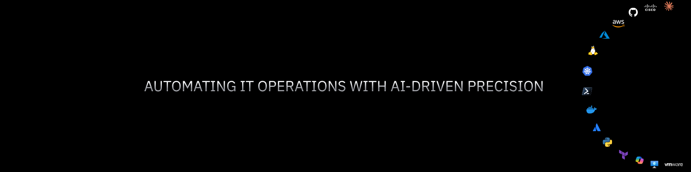
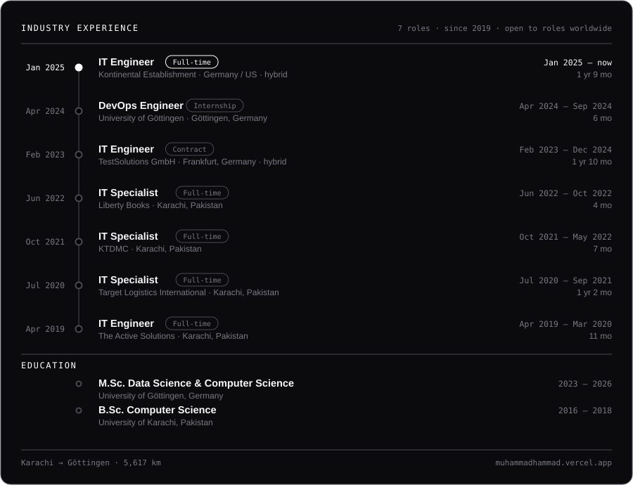

  

  

  
  
  

  

  
  
  
  
  
  

<picture>
  <source media="(prefers-color-scheme: dark)" srcset="assets/brands-dark.svg?v=44"/>
  <source media="(prefers-color-scheme: light)" srcset="assets/brands-light.svg?v=44"/>
  
</picture>

  

  
  
  
  
  
  
  
  

---

  

